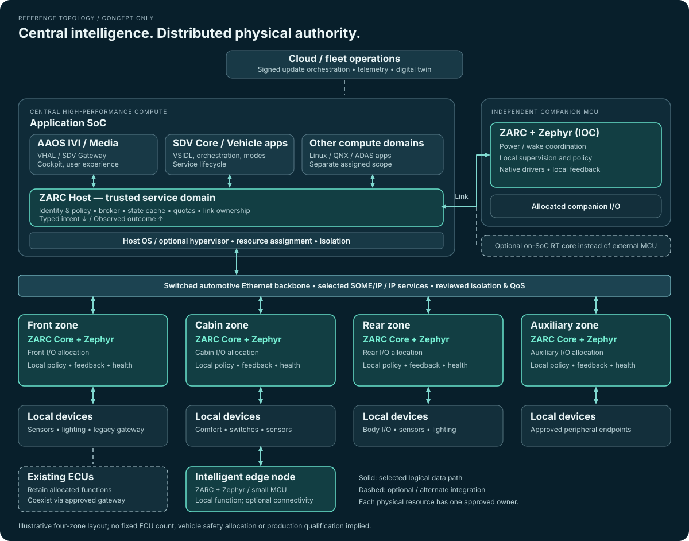
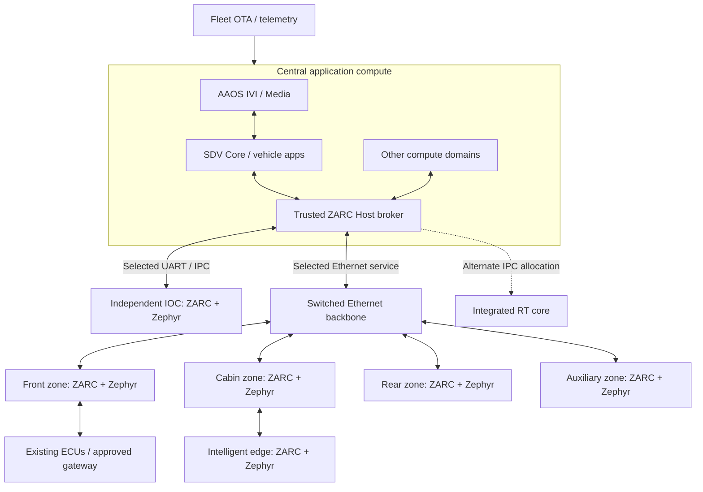
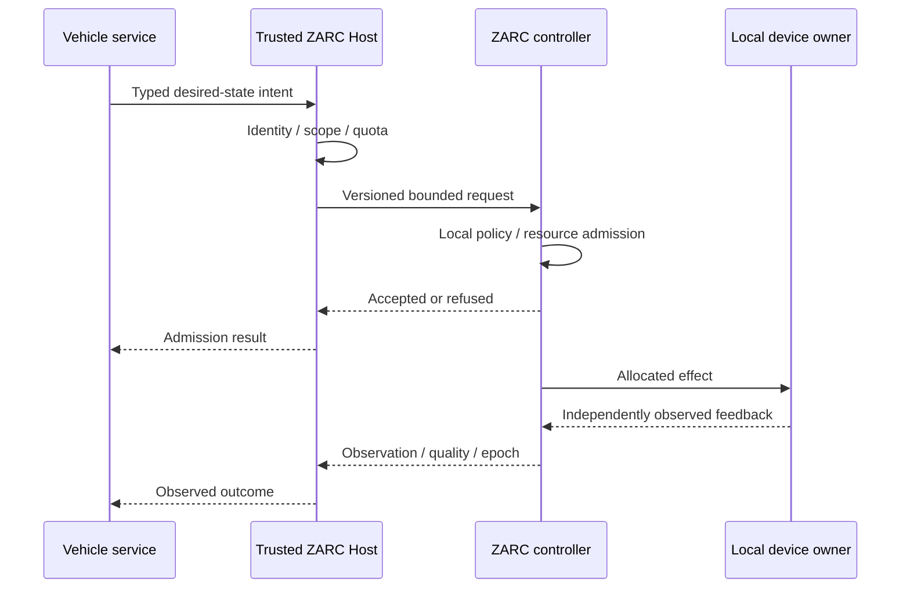

# ZARC — Distributed to intelligent SDV reference architecture

> **ZARC 2035 | Proposed design baseline | 28 November 2026.** The single normative-candidate register is [Z12](12-Requirements-Verification.csv) (267 requirements). This is not evidence of implementation or production qualification.

## Four placements, one foundation
Standalone distributed ECUs over legacy networks; domain/hybrid controllers; central compute with zones and edge nodes; heterogeneous central AI with real-time islands. Common component descriptors, typed contracts, native configuration and resource authority remain invariant. Optional observation and management plane reconciles inventory, health, correlations and deployment units without blocking local control. Existing sedan visualization remains a simulated, read-only reference, not a production design or actual measured vehicle topology.

## Retained engineering detail and historical context
Existing design detail is retained for trace continuity. The current Z12 and preceding architecture govern where wording differs; historical counts, findings, examples and acceptance claims are scoped to their original revision.

**Status: proposed, informative architecture reference.** It does not amend the authoritative Z12 requirements register or establish product qualification. [Rendered GitHub Pages view](https://susmithmrm.github.io/ZARC/modern-architecture.html) · [Vector source](../../site/assets/modern-sdv.svg).

## 1. Recommended topology

Centralize high-level vehicle software on application compute and keep allocated time-sensitive physical functions on autonomous ZARC + Zephyr domains. A trusted service process/VM owns the selected controller link. The initial profile is an external companion MCU; optional integrated RT is an alternate allocation for the same physical resource, never a competing writer. Four zones are illustrative, not a hardware bill of materials. Smart-edge instances may operate without the host. Existing ECUs and independently qualified safety islands can coexist via approved boundaries.

## 2. Allocation and boundaries

| Layer | Proposed responsibility | Ownership restriction |
|---|---|---|
| Fleet | Signed update campaigns, telemetry, digital twin | No direct physical command path |
| AAOS SDV / applications | High-level intent, mode and service lifecycle | No direct raw peripheral access |
| Host | Authenticated policy, quota, correlation, selected physical link | No physical result fabrication |
| ZARC Core/Connect | Local admission, device policies, lifecycle, bounded queues, observation | No unallocated vehicle authority |
| Zephyr | Native RT execution, drivers, device tree, selected PM/IPC/storage | No extra general RTOS facade |
| Existing ECUs | Previously allocated functions | No assumed migration of safety obligations |

Actual SoC hypervisor, VM layout, network topology, physical bus, protocols, device mappings, fault containment and credentials are product decisions. The drawing's Ethernet is a logical switched backbone; selected SOME/IP/IP providers, VLAN/QoS and time synchronization must be reviewed. CAN/CAN FD or LIN may serve allocated legacy/local I/O; no raw bus access from guests. Use native IPC for the integrated profile only after ownership and isolation evidence. An external MCU is preferable where an independent reset/power domain is required and approved.

## 3. Operational sequence

Host restart invalidates cached assumptions and outstanding intent; new session, discovery and fresh snapshot are required. No automatic stale write replay. On link/zone loss, other independent domains continue only as allocated; affected observations become unavailable/stale. Guest readiness does not establish rail state. OTA eligibility, signed-image verification, local power policy, recovery and independent physical feedback require product-specific validation.

## 4. Adoption sequence

1. Benign IOC companion bench and approved link.
2. Smart-edge reuse with a second independently configured product and board.
3. Zonal expansion with approved service allocation and peer interoperability.
4. Integrated RT profile only after SoC resource and fault-domain analysis.
5. Vehicle release only with accepted HIL, timing, security and safety evidence.

## 5. Existing implementation and evidence

The reference repository has portable contracts and laboratory implementations; earlier CI runs record desktop, native simulator, generated gRPC and local COVESA runtime evidence. That is not actual OEM AAOS VHAL, VSIDL, independent Ethernet peer, production MCU authentication or physical vehicle validation. See [implementation status](../IMPLEMENTATION-STATUS.md), [requirements trace](../REQUIREMENT-TRACE.csv), [system architecture](02-System-Architecture.md) and [central compute](07-Central-Compute-SDV.md). No new normative requirement or safety claim is made.

## 6. Upstream references

- [AOSP AAOS SDV](https://source.android.com/docs/automotive/sdv): execution profiles, inter-VM communication, service bundles and orchestration.
- [AOSP SDV Core integration guide](https://source.android.com/docs/automotive/sdv/workstreams/core/integration-guide): virtualized and direct deployment, VSIDL and gRPC integration.
- [Zephyr IPC service](https://docs.zephyrproject.org/latest/services/ipc/ipc_service/ipc_service.html): selected native backend APIs.
- [COVESA vsomeip](https://github.com/COVESA/vsomeip): candidate standard runtime integration.

These references motivate the proposal; no upstream endorsement, certification or validated compatibility is implied.
