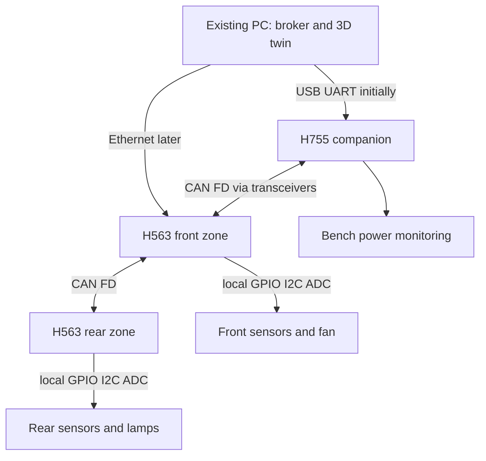

# 22 — ZARC reference SDV bench prototype
Status: proposed, not built. No road vehicle connection, high voltage, real braking/steering, airbag or safety-critical actuation. Use low-voltage current-limited supplies, fused branches, guarded small motors and independent physical output disable. All values below are planning targets.

## Objectives
Demonstrate native Zephyr, physical feedback, local autonomy, multiple controllers, hardware portability, host integration and live 3D sedan. Start with benign lamps, fan and servo; no real vehicle control. Use existing PC for Linux host and browser. Initial board candidates NUCLEO-H755ZI-Q and NUCLEO-H563ZI; NXP MR-CANHUBK344 as later automotive target. Confirm pinned Zephyr board support, driver APIs, electrical limits and pin assignment before ordering. Integrated RT profile requires separate heterogeneous SoC evaluation; dual-core MCU alone is not proof of integrated HPC isolation.

## Topology

One host, three physical MCUs initially. Edge profile runs independently on fourth optional board. Standard Ethernet via switch is not automotive Ethernet; introduce matched 100BASE-T1 media hardware only later. Use two CAN terminations at bus ends, common reference as appropriate, short bench cable, compatible transceivers and verified voltage levels. No pin numbers frozen until schematic and DTS review.

## Functional allocation

| Node | Inputs | Outputs | Demonstration |
|---|---|---|---|
| Companion | supply current/voltage, wake switch, host health | status LEDs, benign enable output | host restart, local policy |
| Front | 2 ToF, 2 ultrasonic, 2 Hall wheel, steering encoder, light, rain, IMU, temperature | headlamps, fan, wiper servo | local sensing and independent feedback |
| Rear | 2 ToF, 2 ultrasonic, 2 Hall wheel, door/trunk switches, seat FSR, temperature/humidity, load cell | rear lights, window servo | parking and body state |
| Optional edge | temperature, Hall, light | LED | autonomous operation |
| Host | USB cameras, GNSS optional, telemetry | display only | perception/status visualization |

Representative signals include sensor values, validity, timestamp, feedback, health, power and network state. Count physical channels separately from derived and simulated signals. Target 50 representative signals, not 50 unique physical sensors. Expensive radar, TPMS, exhaust, high voltage BMS and safety sensors are simulated and labeled. Camera raw streams go to PC, not MCU. All sensor data includes unit, quality, source and timestamp.

## Implementation sequence
1. Record board revisions, schematics, pinned west manifest, actual pinmux and current budget. Flash stock Zephyr sample; test GPIO, UART, ADC, I2C, CAN, Ethernet individually where available.
2. Bind physical indicator provider to existing runtime with independently sensed feedback; preserve ownership and deadline semantics.
3. Add sensor providers one at a time. Test disconnection and stale readings. Add fan/servo only with separate rated supply and output disable.
4. Connect second board using physical CAN FD; verify independent peer, session restart, bounded queues and local autonomy. Add third node.
5. Connect host through existing broker, initially UART; then independent Ethernet peer. Read telemetry into 3D twin via local read-only bridge; static GitHub Pages is not a hardware gateway.
6. Optional automotive NXP port, LIN, T1 Ethernet and edge profile; later actual integrated SoC and AAOS VHAL.
7. Collect raw traces, manifests, build hashes, measurements and acceptance review. Do not claim production or safety qualification.

## Software composition
Reuse existing profile manifests, runtime dispatcher, native provider contracts and host mappings. Add target-specific overlays and benign device providers; no new general middleware. Proposed directories: products/reference-bench, config/targets/bench-*, tests/hil/reference-bench. These paths are proposals, not implemented files. Allocate baseline SYS/RT/PL/CON/VER and the applicable ZARC-ADOPT requirements in Z12 by applicability, not blanket closure.

## Electrical review checklist
Verify module datasheets, 3.3 V logic tolerance, pull-ups, unique I2C addresses or mux, ADC range, transceiver standby, connector pinout, ground and branch current; separate motor rail, avoid backfeeding USB, add flyback protection where appropriate. Use certified enclosed supplies; no mains wiring. Inspect wiring unpowered and enable one branch at a time. Physical emergency disable disconnects actuator supply independently of MCU. Freeze actual wiring table after board selection.
